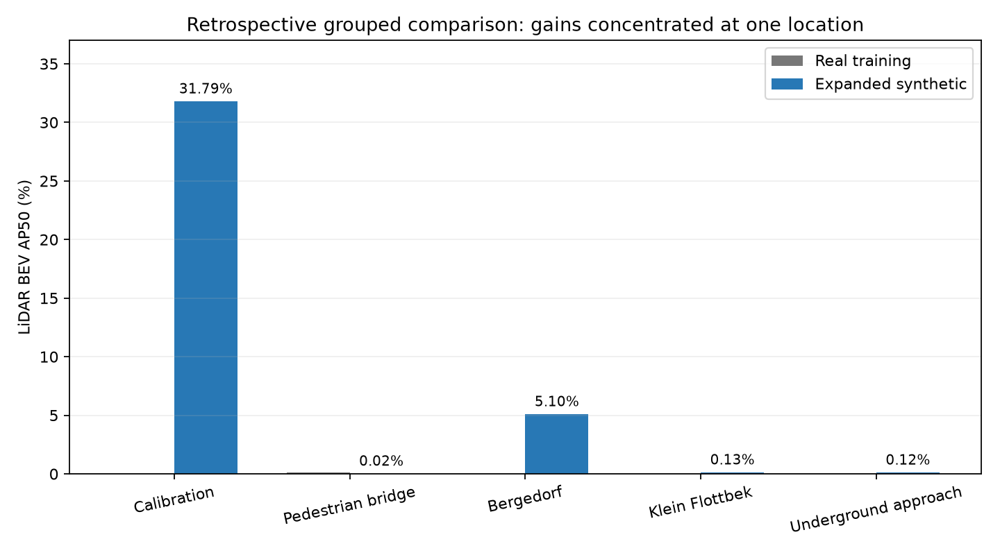

# Retrospective location-grouped LiDAR comparison

Retrospective grouped CV; all locations previously exposed in this project. Not a fresh blind benchmark.

Each outer fold holds out one positive location group, validates on another and trains on the other three. All ten runs were completed and checkpoints frozen before any new outer-test scores were inspected. Same YOLO26s initialization, seed 23, optimizer and 30 epochs. Within each fold, real and synthetic frame counts and positive/negative frame counts match. Supported object counts and physical diversity differ.

| Positive test location group | Real BEV AP50 | Synthetic BEV AP50 |
|---|---:|---:|
| 1 | 0.00% | 31.79% |
| 4 | 0.10% | 0.02% |
| 5 | 0.00% | 5.10% |
| 6 | 0.00% | 0.13% |
| 7 | 0.00% | 0.12% |

| Aggregate | Real | Synthetic |
|---|---:|---:|
| equal_weight_location_mean_AP50 | 0.02% | 7.43% |
| equal_weight_location_mean_AP50_95 | 0.00% | 3.97% |
| pooled_out_of_fold_AP50 | 0.05% | 0.51% |
| pooled_out_of_fold_AP50_95 | 0.01% | 0.25% |

Only five location groups have road_vehicle cuboids fully inside the 160m x +/-40m ROI. All have prior project exposure. Creating train/validation/test each with multiple positive locations would need at least six disjoint positive locations. A genuinely fresh external holdout is unavailable locally.

Only one seed. Vehicle observations within sequences are correlated. This is a post-diagnostic development experiment and does not restore blindness to previously exposed locations. Additional unseen sequences are needed for independent confirmation. Metrics are LiDAR-only axis-aligned BEV, single road_vehicle class; not full 3D AP.

## What changed and why

The annotation inventory found only five positive location groups. The benchmark therefore rotates entire locations through training/validation/test instead of claiming that known frames form a fresh blind holdout. Repeated positive training frames are capped by location, and all supported vehicle IDs are retained in selected training groups. The expanded 320-scene synthetic pool adds both-side full-ROI placement, headings, elevations and procedural scan/dropout variation. All eight vehicle families and every side/range band passed audits, with zero placement fallbacks.

## Actual training budgets

The new folds have smaller training sets than the earlier 320-frame experiment, so these numbers are not a direct before/after comparison with the earlier 23.93% validation score. Budgets match within each real/synthetic pair.

| Fold | Frames per source | Positive / negative frames per source | Real / synthetic supported training boxes |
|---|---:|---:|---:|
| 0 | 110 | 50 / 60 | 180 / 283 |
| 1 | 120 | 60 / 60 | 167 / 333 |
| 2 | 150 | 90 / 60 | 151 / 473 |
| 3 | 170 | 110 / 60 | 175 / 557 |
| 4 | 129 | 80 / 49 | 215 / 428 |

## Fixed confidence 0.25, independent overlap check

| Training source | TP | FP | FN | Precision | Recall |
|---|---:|---:|---:|---:|---:|
| real | 0 | 0 | 589 | 0.00% | 0.00% |
| synthetic | 43 | 3210 | 546 | 1.32% | 7.30% |

The synthetic equal-weight average is driven mainly by calibration-site performance. Pooled AP remains low because many vehicles occur at poorly detected locations, false positives remain high, and scores across independently trained fold models need not be equally calibrated. Neither model is reliable across locations. All 400 frames and 589 supported boxes appear exactly once per training source in out-of-fold scoring. Independent greedy IoU matching reproduces the reported fixed-threshold counts.

## Remaining data and model limits

The synthetic pool has 997 supported boxes, of which only 67 have fewer than 50 points; very sparse cases are still underrepresented overall. Fold subsets prioritize sparse coverage, but appearance, sensor response, eight reused mesh families and background geometry remain approximate. Equal positive-frame counts do not mean equal object counts or independent-vehicle diversity. No additional unseen real vehicles were created by regrouping. A fresh external holdout is still required.

